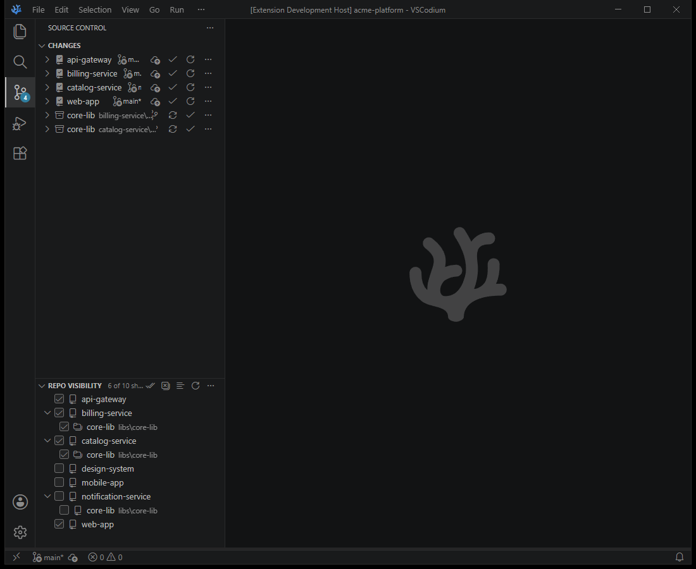

# Repo Visibility

Hide and show Git repositories in the **Source Control** view with one click.

When a workspace contains many repositories (multi-root workspaces, monorepos with nested repos, projects full of submodules), the Source Control view lists every one of them, and the repository you are working on gets lost in the list. Repo Visibility adds a small **Repo Visibility** panel to the Source Control sidebar with a checkbox per repository: uncheck a repository to hide it, check it to bring it back.

## Features

- **One checkbox per repository.** Unchecked repositories disappear from Source Control; checked ones come back.
- **Finds every repository in the workspace.** The workspace folders are scanned on disk, so the list also contains repositories the Git extension never opened: ones deeper than `git.repositoryScanMaxDepth`, or ones closed in an earlier session. Check one to add it to Source Control.
- **Knows submodules from repositories.** Submodules are read from each repository's `.gitmodules` (at any depth) and shown with a submodule icon under the repository that contains them. Linked worktrees get their own icon too. Switch to a flat list sorted by name if you prefer.
- **Bulk actions** in the panel's title bar: show all, hide all, and *Choose Visible Repositories...*, a multi-select picker that is also in the Source Control view's `...` menu and the Command Palette.
- **Show only this repository**, plus Show / Hide / Reveal in File Explorer, from the right-click menu. Select several rows to act on all of them at once.
- **Remembered per workspace.** Hidden repositories stay hidden after a reload or restart, and repositories you showed come back even if Git would not have opened them on its own.
- **Says why a repository won't open.** If Git refuses one (for example because of "dubious ownership", or a submodule whose `.git` file points nowhere), it gets a warning icon and the tooltip shows the reason.
- **Works with Git's own Close Repository.** A repository you close from the Source Control view shows up unchecked in the panel, so you can bring it back with one click.
- The panel title shows how many repositories are visible, for example `3 of 12 shown`, whenever some are hidden.

## Usage

1. Open a folder or workspace with more than one Git repository.
2. Open the **Source Control** view (`Ctrl+Shift+G`, `Cmd+Shift+G` on macOS).
3. Expand the **Repo Visibility** panel. You can drag it above the *Changes* view, or move it anywhere you like.
4. Uncheck the repositories you don't need right now.

### Commands

| Command | Where |
| --- | --- |
| Show All Repositories | Panel title bar, Command Palette |
| Hide All Repositories | Panel title bar, Command Palette |
| Choose Visible Repositories... | Panel `...` menu, Source Control `...` menu, Command Palette |
| View as List / View as Tree | Panel title bar, Command Palette |
| Refresh | Panel title bar, Command Palette |
| Show / Hide Repository | Right-click a repository |
| Show Only This Repository | Right-click a repository |
| Reveal in File Explorer | Right-click a repository |
| Forget Repository | Right-click a hidden repository |

### Settings

| Setting | Default | Description |
| --- | --- | --- |
| `repoVisibility.viewMode` | `tree` | `tree` nests submodules and nested repositories under their parent; `list` shows every repository on its own row. |
| `repoVisibility.scanDepth` | `4` | How many folder levels below each workspace folder are searched for repositories. Submodules in `.gitmodules` are always found. `0` searches only the workspace folders themselves. |
| `repoVisibility.scanIgnoredFolders` | `node_modules`, `bin`, `obj`, ... | Folder names that are not searched. Folders starting with `.` are always skipped. |

## How it works

VS Code has no API for filtering the Source Control view, so Repo Visibility uses the built-in Git extension instead: hiding a repository **closes** it in Git (the same as *Close Repository* in the Source Control view), and showing it **opens** it again. That means:

- A hidden repository is not watched by Git, so it gets no Git decorations in the Explorer and no status bar branch while it is hidden. Show it again whenever you need them.
- Your files are never touched. Hiding and showing only changes what Git tracks in the current window.
- Repositories found on disk that Git has not opened are listed unchecked; checking one opens it in Git.
- The hidden and shown choices are stored in the workspace's state, so each workspace has its own.

## Requirements

- VS Code 1.80 or later, or a compatible editor such as VSCodium.
- The built-in Git extension must be enabled (`git.enabled`).
- If a repository is missing from the list, raise `repoVisibility.scanDepth` and press Refresh. The *Repo Visibility* output channel logs how many repositories and submodules the scan found.

## Feedback

Found a bug or have an idea? [Open an issue](https://github.com/armanossiloko/repo-visibility/issues).

## License

[MIT](LICENSE)
